# RevZone Auto – Auto Parts E-Commerce Website


RevZone Auto is an online store for car parts that I built from scratch with **plain PHP and MySQL** –
no framework, and only a little JavaScript.

The site has two types of users:
- **Customers** – browse parts, buy them, choose home delivery or branch pickup, track orders and talk to support.
- **Business owner (admin)** – manages users, products, deliveries and customer support.

I built this project to understand how a real web shop works from the inside: accounts and roles,
cart and checkout, stock, deliveries, emails, support tickets – and how to keep all of it secure.

---

## Screenshots

### Customer side

| Home page | Products |
|---|---|
| 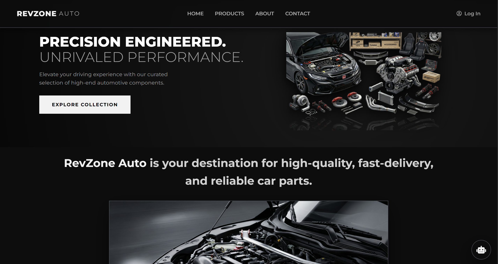 | 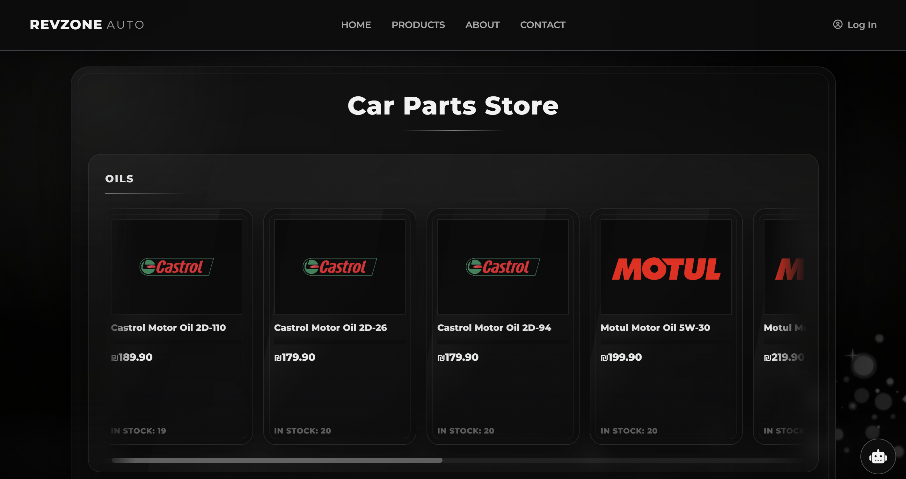 |

| Cart | Checkout |
|---|---|
| 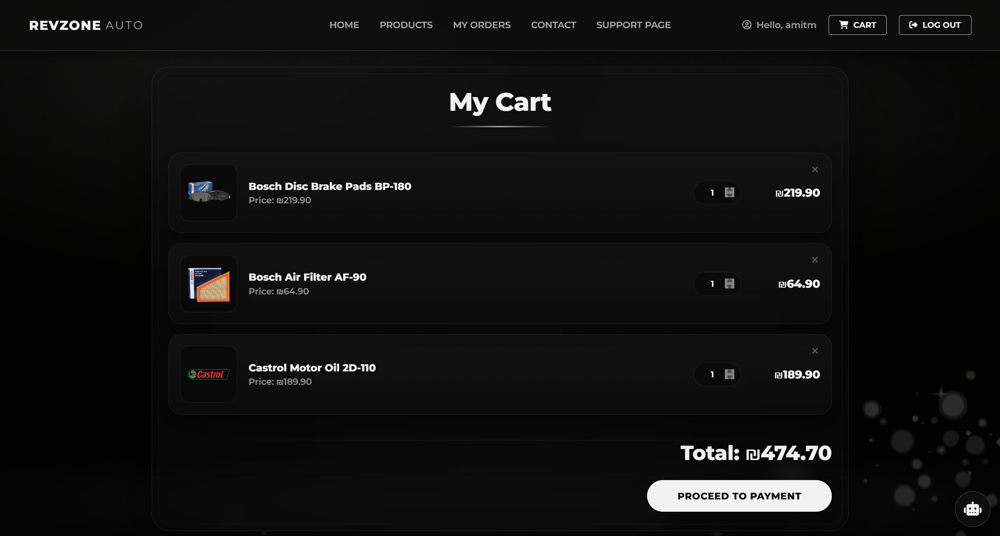 | 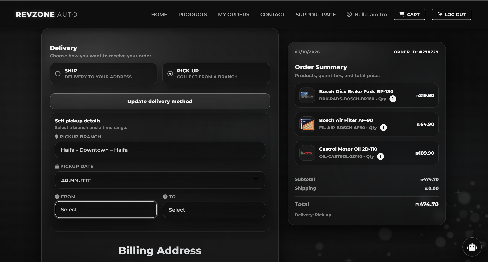 |

| My orders | Receipt |
|---|---|
| 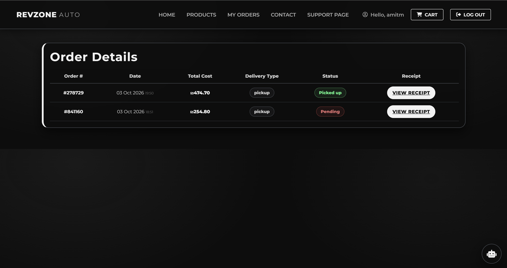 | 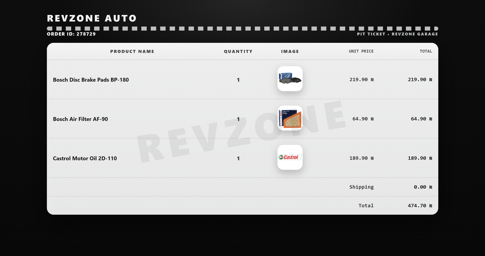 |

| Chatbot – part fitment | Support ticket |
|---|---|
| 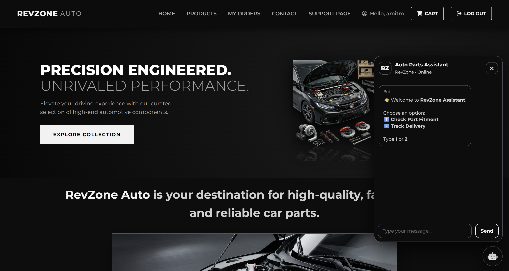 | 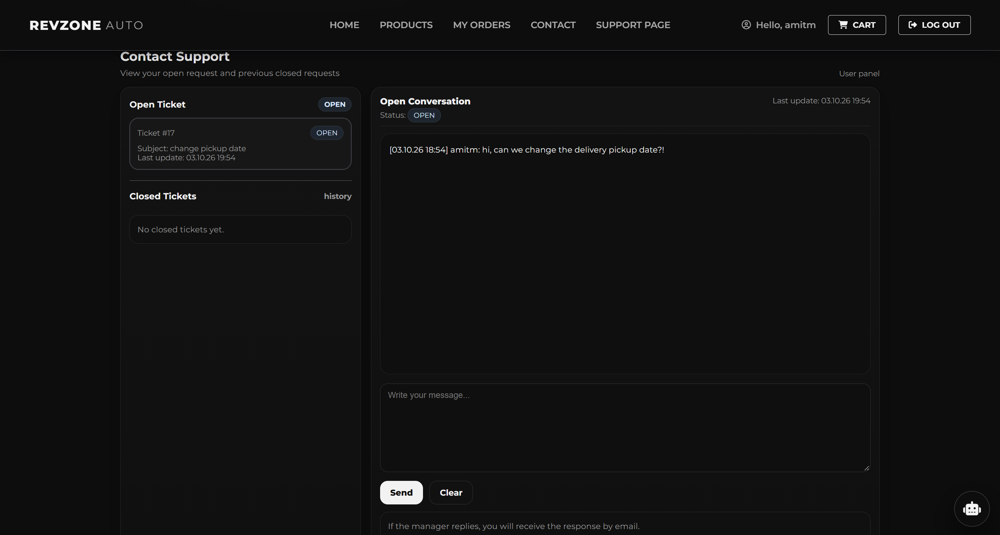 |

### Admin side

| Manage deliveries | Manage products |
|---|---|
| 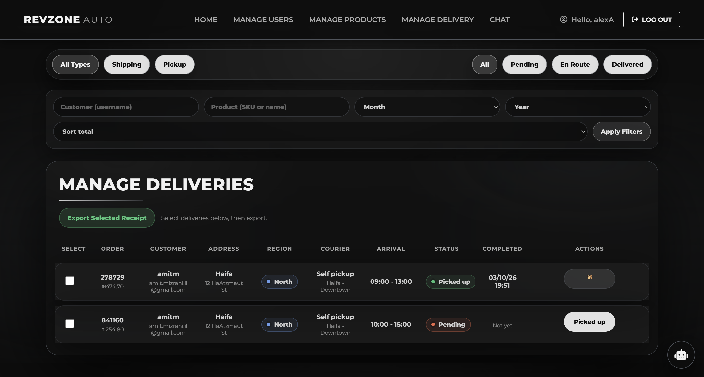 | 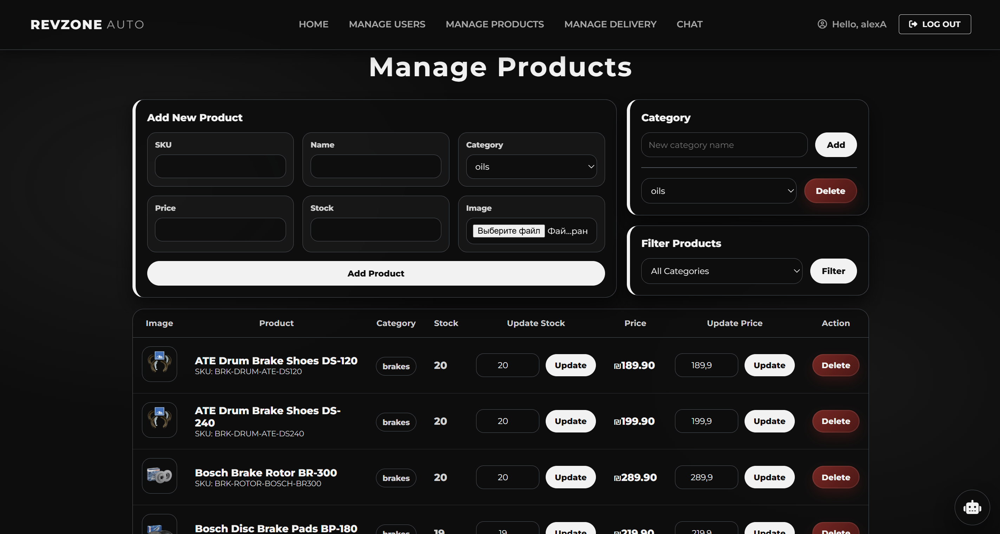 |

| Manage users | Support center |
|---|---|
| 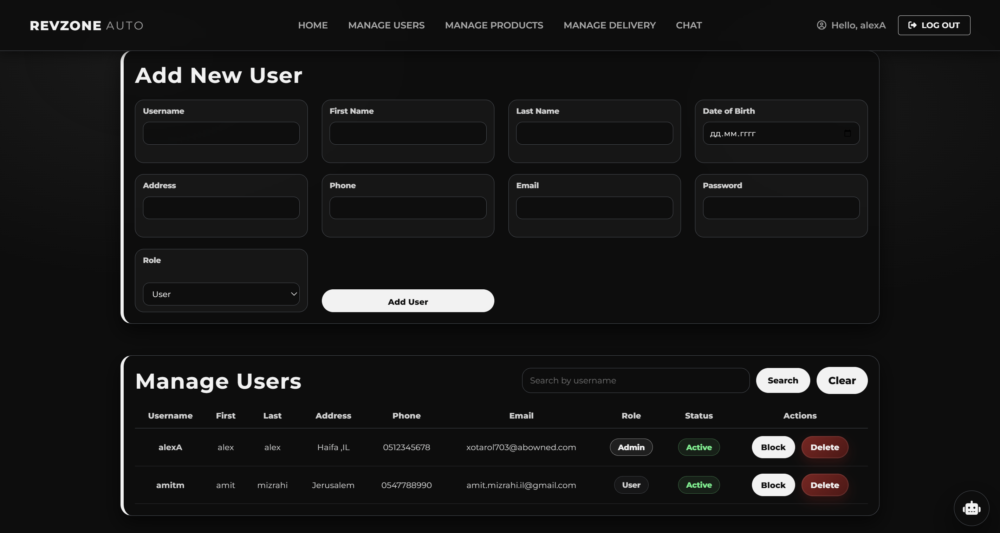 | 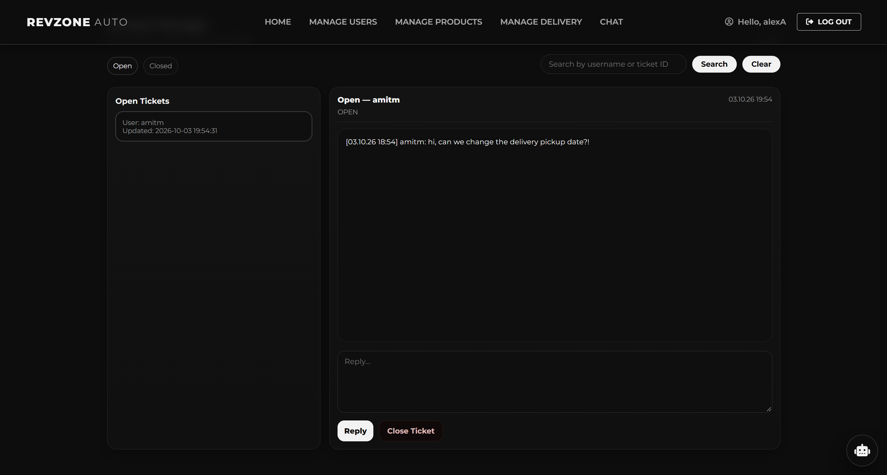 |

---

## Features

### Customer
- **Account** – sign up (with validation and an 18+ age check), log in, profile page, change password
  (the new password can't be one of the last 3), forgot password.
- **Products** – browse parts by category, see the price and how many are in stock.
- **Cart** – add products, change quantities, remove items. The cart never lets you take more than what is in stock.
- **Checkout**
  - Home delivery (₪39) or **free pickup** from a branch, with a pickup date and time window.
  - Every field is validated.
  - Demo payment form – no real payment is processed.
- **My Orders** – all my orders with the total, delivery type and live status:
  Pending → En Route → Delivered / Picked up.
- **Receipts** – a receipt for every order. Only the customer who made the order (or an admin) can open it.
- **Support** – open a support ticket, chat with the admin, and see old closed tickets.
- **Emails** – welcome email, order confirmation, "your order is on the way", delivered, canceled, and support replies.
- **Chatbot assistant**
  - **Part fitment:** brand → model → year → engine → category, and it shows the parts that fit the car.
  - **Delivery tracking** by order number.

### Business owner (admin)
- **Manage users** – add users (customer or admin), search, block / unblock.
  Users who already have orders can't be deleted, so the sales history is kept.
- **Manage products** – add products with an image, update stock and price, add and delete categories,
  filter by category, remove products from the store and restore them.
- **Manage deliveries**
  - Filter by delivery type, status, customer, product, month and year, and sort by order total.
  - Assign a courier from the customer's region with an arrival time.
  - Mark orders as delivered / picked up.
  - Cancel an order – the stock goes back automatically.
  - Export the selected deliveries as a printable report.
- **Support center** – search tickets, reply (the customer gets an email), and close tickets.

---

## Tech stack

| | |
|---|---|
| Backend | PHP 8.2 – procedural, no framework, `mysqli` |
| Database | MySQL / MariaDB – 14 tables connected with foreign keys |
| Frontend | HTML, CSS, a little vanilla JavaScript (chatbot and small UI helpers) |
| Local server | XAMPP (Apache + MariaDB) |

---

## Security

Security was a big part of this project. These are the main problems I protected the site from:

| Problem | How I handled it |
|---|---|
| SQL injection | Every query with user data uses prepared statements (`mysqli_execute_query` with `?` placeholders). |
| Stolen passwords | Passwords are never saved as plain text – they are hashed with `password_hash()` and checked with `password_verify()`. |
| XSS (injected scripts) | All text from users and from the database is escaped with `htmlspecialchars()` before it is shown. |
| Blocked users | A blocked user can't log in, and if they are already logged in they are logged out on their next click. |
| Guessing passwords | After 3 wrong passwords the account gets a new password by email, and it must be changed at the next login. |
| Half-saved orders / selling the same last item twice | Checkout and order cancel run inside database transactions, and the products are locked while the order is saved (`SELECT ... FOR UPDATE`). |
| Uploading dangerous files | Product images are checked by their real file type and size, saved with a random name, and PHP files can't run from the images folder (`.htaccess`). |
| Private receipts | Receipts are built from the database and only shown to the order owner or an admin. |
| Session hijacking | A new session ID is created when the user logs in. |
| Passwords in the repository | The real database settings file is not uploaded (`.gitignore`); an example file is included instead. |

---

## How to run it locally

**You need:** [XAMPP](https://www.apachefriends.org/) with **PHP 8.2 or newer**.

1. **Get the code**
   Download or clone this repository into XAMPP's `htdocs` folder, and name the folder `phpProject`:
   ```
   C:\xampp\htdocs\phpProject
   ```
2. **Start XAMPP**
   Open the XAMPP Control Panel and start **Apache** and **MySQL**.
3. **Create the database**
   - Open http://localhost/phpmyadmin
   - Click **New**, name the database `revzone_db`, and click **Create**
   - Select `revzone_db` → **Import** → choose `database/revzone_db.sql` → **Go**
4. **Database settings**
   Copy `revZone_DB.example.php` and name the copy `revZone_DB.php`.
   XAMPP's default settings are already inside (user `root`, empty password, port `3306`).
   If your folder has a different name than `phpProject`, change `SITE_URL` in the same file.
5. **Open the site**
   http://localhost/phpProject/revZone.php

> **About emails:** the site sends emails with PHP's `mail()` function. On XAMPP this works only after
> setting up an SMTP server in `php.ini` and `sendmail.ini`. Everything else works without it.

---

## Demo accounts

| Role | Username | Password |
|---|---|---|
| Admin (business owner) | `demo_admin` | `Admin1234` |
| Customer | `demo_customer` | `Customer1234` |

The database already includes 27 products in 4 categories, 58 cities, pickup branches, couriers,
and car models for the chatbot's part-fitment search.

---

## Project structure

```
phpProject/
├── revZone.php              Home page
├── about.php                About page
├── products.php             Product catalog
├── cart.php                 Shopping cart
├── checkout.php             Checkout (delivery / pickup + payment form)
├── ordercomp.php            Order confirmation animation
├── myorders.php             Customer's order history
├── receipt.php              Order receipt (owner / admin only)
├── contact.php              Open a support ticket
├── contactUser.php          Customer support page (open + closed tickets)
├── profile.php              Account page
├── logIn.php / logout.php   Log in / log out
├── signUp.php               Registration
├── forgot.php               Forgot password
├── changePass.php           Change password
├── manageU.php              Admin – users
├── manageP.php              Admin – products and categories
├── manageD.php              Admin – deliveries
├── contactManager.php       Admin – support tickets
├── nav.php                  Shared logic: database connection, session, role and block check
├── header.php               Shared navbar (HTML)
├── revZone_DB.example.php   Database settings template (copy it to revZone_DB.php)
├── chatbot/                 Chatbot (UI, style, JavaScript and PHP logic)
├── database/revzone_db.sql  Database structure + demo data
├── img/                     Product and site images
├── screenshots/             Images for this README
└── *.css                    One stylesheet for each page
```

---

## Known limitations and future improvements

Things I know can be better, and would add next:

- **Password reset** sends a new password by email. A one-time reset link would be more secure.
- The **wrong-password counter** is saved in the session, so clearing the cookies resets it. Saving it in the database would be stronger.
- **Forms don't have CSRF tokens** yet.
- **Emails** depend on PHP `mail()` and an SMTP setup. A mail library like PHPMailer would be more reliable.
- **Payment** is only a demo form – no real payment provider is connected.
- Each support ticket keeps the whole chat in one text field. A separate messages table would allow more features.

---

## What I learned

This project taught me much more than I expected when I started it. In the beginning every query was built
by putting the user's text straight into the SQL, and the passwords were saved as plain text – it worked,
but it wasn't safe. I went back over the whole project and moved every query to prepared statements,
hashed all the passwords, and escaped everything that is shown on the page, so now I understand why
SQL injection and XSS happen and how to stop them.

I also learned how to use database transactions, so an order is saved completely or not at all, how to
lock the stock so two customers can't buy the same last item, and how to separate the page logic
(`nav.php`) from the HTML (`header.php`) so every page starts correctly. Fixing my own old code step by
step showed me how to find bugs, test each change, and keep the project working while improving it.

---

## Author

**Maxim Banna** – https://github.com/MaximBanna
